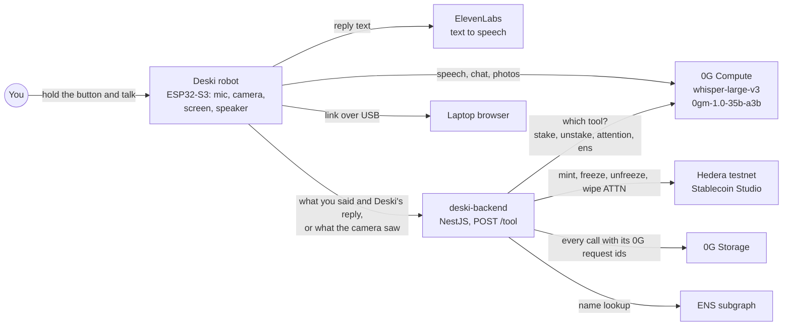
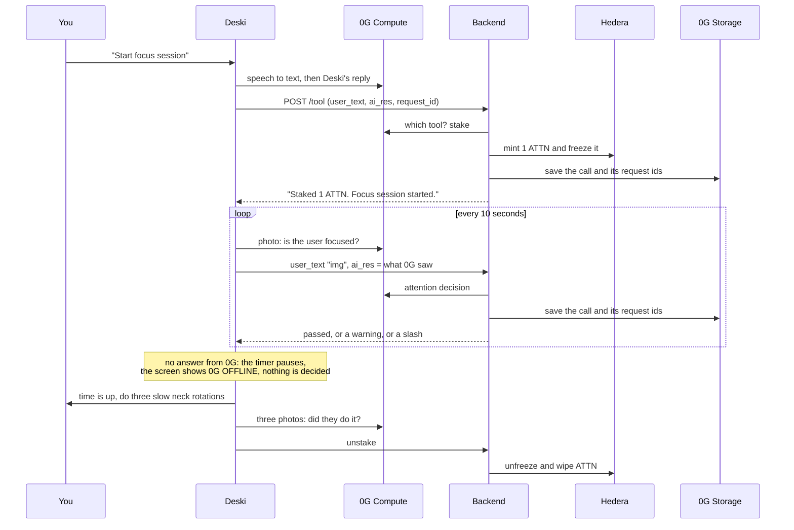

# Deski

Deski is a small desk robot that keeps you focused, with your own stake on the line. Built at ETHGlobal Mumbai 2026.

The project page is live at https://deski.bluntbrain.com (hosted on Netlify).

You tell Deski to start a focus session, and it stakes 1 ATTN for you on Hedera. Its camera checks on you every 10 seconds, and a 0G vision model decides if you are focused. If you lose focus, Deski warns you first and slashes your stake the second time. When the time is up, Deski asks for three slow neck rotations. If the camera sees them, your stake comes back.

Every decision runs on 0G: speech to text, chat and vision. If 0G cannot be reached, Deski does not guess and does not switch to another model. It pauses the timer and shows "0G OFFLINE" until 0G answers again.

## Status

| Part | State |
| --- | --- |
| Hardware: ESP32-S3, screen, mic, speaker, camera, push-to-talk button | Working on two breadboards |
| Voice: 0G speech to text and 0G chat, ElevenLabs voice, reply typed on screen | Working (`firmware/desky_talk`) |
| Focus sessions: stake, 0G vision check every 10 s, warning, slash or unstake | Working, tested on the board |
| Safe stop: no fallback model, "0G OFFLINE" on screen, timer paused | Working |
| Stake on Hedera: ATTN token managed with Stablecoin Studio (mint, freeze, unfreeze, wipe) | Working (`deski-backend`). The USDC transfer behind the stake is switched off until our test account has testnet USDC. |
| 0G Storage log of every decision, with its 0G request ids | Working when `OG_STORAGE_PRIVATE_KEY` is set and the wallet has test 0G |
| Live camera view on a laptop | Working |
| "Look up an ENS name": Deski finds it and opens its page on your laptop | Built, not yet tested end to end on the board |
| Pixel characters | Working (`firmware/desky_pets`) |

## How it works

A focus session, step by step:

1. You hold the button and talk. Deski sends the audio to 0G (`whisper-large-v3`, which runs in a TEE).
2. 0G's own model (`0gm-1.0-35b-a3b`) writes Deski's reply. ElevenLabs reads it out, and the screen types it.
3. Deski sends what you said, its reply and the 0G request id to the backend. The backend asks 0G which tool to run: stake, unstake, attention or ens.
4. A stake mints 1 ATTN with Stablecoin Studio and freezes it on Hedera. An unstake or a slash unfreezes and wipes it.
5. During a session, Deski takes a photo every 10 seconds and asks 0G vision what it sees. It sends that sentence to the backend as `ai_res`, with `user_text: "img"`, and the backend's 0G call decides if you are focused.
6. The backend saves every call to 0G Storage, with both 0G request ids: Deski's own call and the backend's decision.

## Partner tracks

| Track | How Deski uses it | Where to look |
| --- | --- | --- |
| 0G: Physical AI, Agents with a Body | 0G Compute makes every decision: speech to text, chat, vision checks and the backend's tool choice. Each call is saved on 0G Storage with its request ids. If 0G is unreachable, Deski stops safely and never fakes a decision. | `firmware/desky_talk/desky_talk.ino` (`speechToText0G`, `chat`), `firmware/desky_talk/focus.ino` (`vision`, `attentionCheck`, `safeStop`), `deski-backend/src/tool`, `deski-backend/src/storage` |
| Hedera: Tokenize Anything with Hedera Studios | The stake is ATTN, a token managed with Stablecoin Studio. A stake mints (cash in) and freezes it. An unstake or a slash unfreezes and wipes it. | `deski-backend/src/hedera/hedera.service.ts`, `deski-backend/src/stake/stake.service.ts` |
| ENS | Ask Deski to look up a name. The backend finds it on the ENS subgraph, and Deski opens its eth.limo page on your laptop. | `deski-backend/src/ens`, `firmware/desky_talk/focus.ino` (`focusAfterTurn`), `firmware/desky-link.py` |

## Proof

These are real 0G request ids from one focus session on the board, on 7 November 2026.

| Step | 0G model | Request id | Provider |
| --- | --- | --- | --- |
| Speech to text: "Start focus session" | whisper-large-v3 | `e6e040cb-af12-4c99-a96c-724e3ae082f7` | `0xE63C4F83abFbDFCaB884247EaC21f59e2e8d502e` |
| Deski's reply | 0gm-1.0-35b-a3b | `6062aed7-e8c3-4057-bc97-ce721b0777a4` | `0xf4FB8d2bD856e672b5f9848b0eD235A20079B250` |
| Camera check 1 | 0gm-1.0-35b-a3b (vision) | `0dcc94d2-5e17-4acf-9e6f-b6a87e089322` | `0xf4FB8d2bD856e672b5f9848b0eD235A20079B250` |
| Camera check 2 | 0gm-1.0-35b-a3b (vision) | `2ca8eef9-6157-4a46-a4a9-d33b20fdac4f` | `0xf4FB8d2bD856e672b5f9848b0eD235A20079B250` |

| Onchain record | Link |
| --- | --- |
| 0G Storage root hash of a saved call | To fill in |
| ATTN token on HashScan | To fill in (`https://hashscan.io/testnet/token/<ATTN_TOKEN_ID>`) |
| Stake transactions (cash in, freeze) | To fill in |
| Unstake or slash transactions (unfreeze, wipe) | To fill in |

## Hardware

- ESP32-S3-N16R8 camera board (16 MB flash, 8 MB PSRAM)
- 1.8 inch ST7735 screen, 128 x 160
- INMP441 I2S microphone
- MAX98357A I2S amplifier and a small speaker
- 6 x 6 mm push button (push to talk)

### Wiring

| Part pin | ESP32 GPIO |
| --- | --- |
| Screen CS, RESET, A0, SDA, SCK, LED | 45, 48, 47, 21, 20, 19 |
| Screen VCC, GND | 5V, GND |
| Amp LRC, BCLK, DIN, SD | 38, 39, 40, 42 (SD is driven high to turn the amp on) |
| Amp VIN, GND | 5V, GND |
| Mic WS, SCK, SD | 3, 14, 46 |
| Mic VDD, GND, L/R | 3V3, GND, GND |
| Push-to-talk button | 0 and GND (the board's BOOT button works too) |
| Camera | Ribbon connector on the board |

## Firmware

| File | What it does |
| --- | --- |
| `firmware/desky_talk` | Deski: push to talk, 0G speech to text, chat and vision, focus sessions with camera checks, pixel face, live camera at `http://<deski ip>/` |
| `firmware/desky-link.py` | Runs on the laptop: shows Deski's log and opens the links Deski finds in your browser |
| `firmware/desky_pets` | Plays every pixel character and mood on the screen |
| `firmware/desky_camera_test` | Shows the live camera picture on the screen |

### Firmware setup

1. Install the Arduino IDE, the ESP32 board package by Espressif (3.3.x), and the libraries "Adafruit ST7735 and ST7789" and "ArduinoJson" (v7).
2. Tools menu: ESP32S3 Dev Module, PSRAM: OPI PSRAM, Flash Size: 16MB, Partition Scheme: 16M Flash (3MB APP/9.9MB FATFS), USB CDC On Boot: Disabled. Use the USB-UART port.
3. In `firmware/desky_talk`, copy `secrets.example.h` to `secrets.h`. Fill in your Wi-Fi, your 0G router key (`ZG_KEY`, from https://pc.0g.ai), your ElevenLabs key and the backend address (`BACKEND_URL`). The Wi-Fi must be 2.4 GHz. On an iPhone hotspot, turn on Maximize Compatibility.
4. Each sketch has `#define LAYOUT 2` for the wiring above. Upload, open the Serial Monitor at 115200, hold the button and talk.

### Backend setup

1. At the repo root, copy `.env.example` to `.env` and fill it in. You need your Hedera testnet admin and test accounts, the Stablecoin Studio factory and resolver, the ATTN token, your 0G router key, an ENS subgraph URL, and `OG_STORAGE_PRIVATE_KEY`. That last one is a 0G Galileo testnet wallet with test 0G from https://faucet.0g.ai.
2. Run `cd deski-backend && npm install && npm run start`. The backend listens on port 3000.
3. Make it reachable for Deski, for example with `ngrok http 3000`, and put that address in `BACKEND_URL` in `secrets.h`.

### Live camera and links on your laptop

- **Live camera.** Open `http://<deski ip>/` on a laptop on the same Wi-Fi. Deski prints its address in the log at boot. On a Mac on an iPhone hotspot, the Mac may take only an IPv6 address and fail to reach Deski. If the page does not load, run `networksetup -setv6linklocal Wi-Fi` and rejoin the hotspot.
- **Links.** On the laptop that Deski is plugged into, run `uv run --with pyserial firmware/desky-link.py`. Hold the button and say "Look up vitalik.eth". Deski finds the name, and its page opens in your browser. The helper also shows Deski's live log. It holds the USB port, so close it before you flash new firmware.

## Team

| Name | What they built | GitHub | Telegram | X |
| --- | --- | --- | --- | --- |
| Ishan | Hardware build and wiring, firmware, product | [bluntbrain](https://github.com/bluntbrain) | [@bluntbrainsol](https://t.me/bluntbrainsol) | [@bluntbrain](https://x.com/bluntbrain) |
| Lovish | Backend: 0G tool calls, Hedera Stablecoin Studio, 0G Storage, ENS, project page | [LovishB](https://github.com/LovishB) | [@lovishbadlani](https://t.me/lovishbadlani) | [@luvbweb3](https://x.com/luvbweb3) |
| Yash | Design engineer: the first Deski concept and the design of its faces | | [@Peanut0505](https://t.me/Peanut0505) | [@Yassshhu](https://x.com/Yassshhu) |

## AI usage

Deski itself uses AI at runtime: 0G models for speech to text, chat and vision, and ElevenLabs for the voice. This section is about the AI tools we used to build it.

- **Firmware.** Most of the code in `firmware/desky_talk`, the camera test and the laptop helper `firmware/desky-link.py` was written with Claude Code, Anthropic's coding assistant. Ishan picked the parts, built and wired the hardware, decided how Deski behaves, and tested every change on the real board. Claude Code wrote most of the C++, compiled and flashed it, and read the serial logs with him to fix problems.
- **Design.** Yash designed the Deski concept and its faces. The face code in `firmware/desky_talk` follows his designs.
- **Backend.** Lovish wrote `deski-backend`. Two small changes in `deski-backend/src/tool/tool.service.ts` were made with Claude Code: the optional stake numbers and the longer 0G timeout. Lovish, add here how you used AI tools for the backend and the project page.
- **Docs.** This README was drafted with Claude Code and checked by the team.
